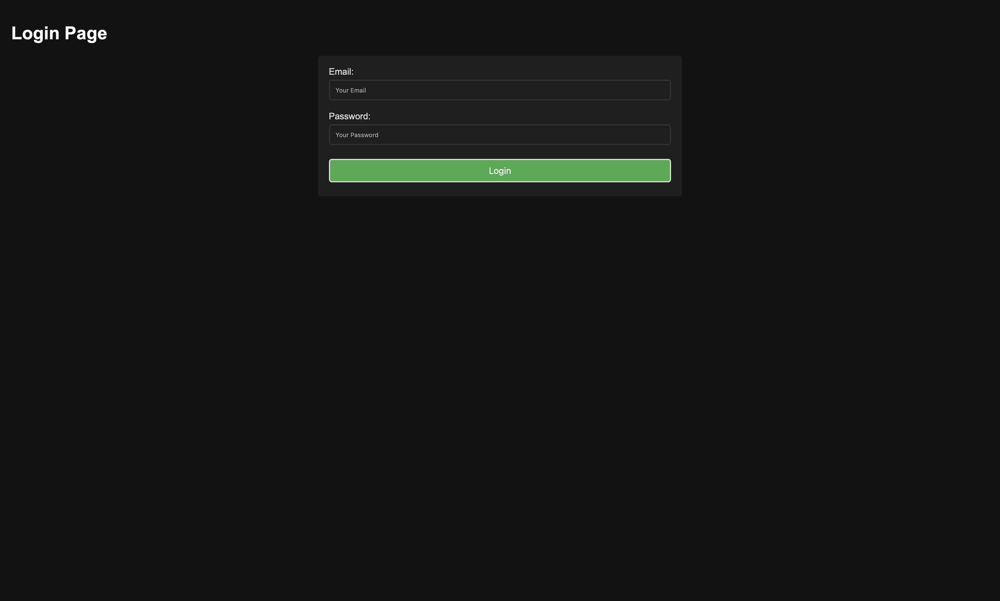
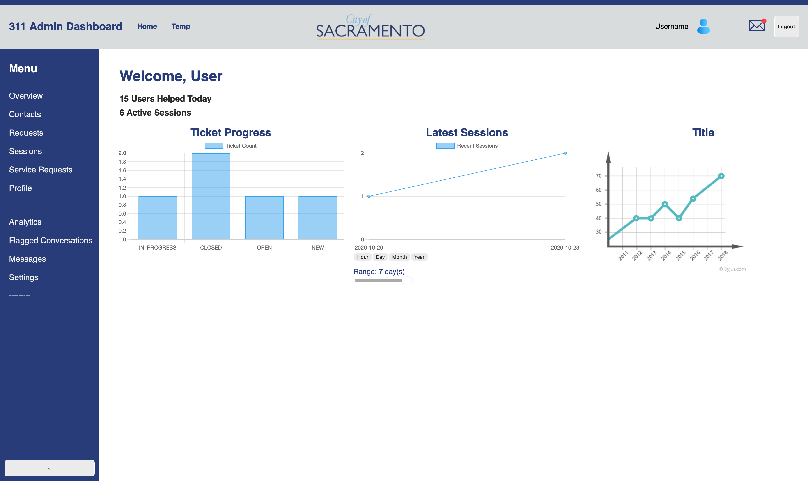
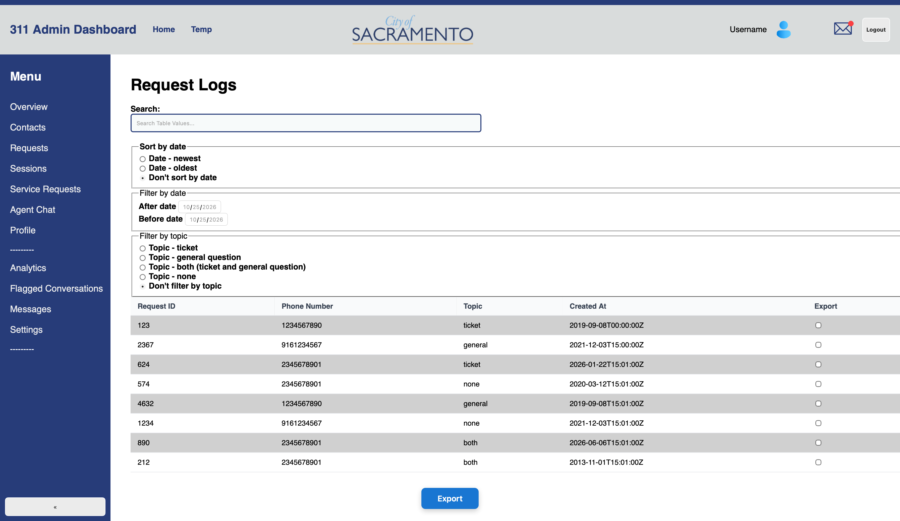
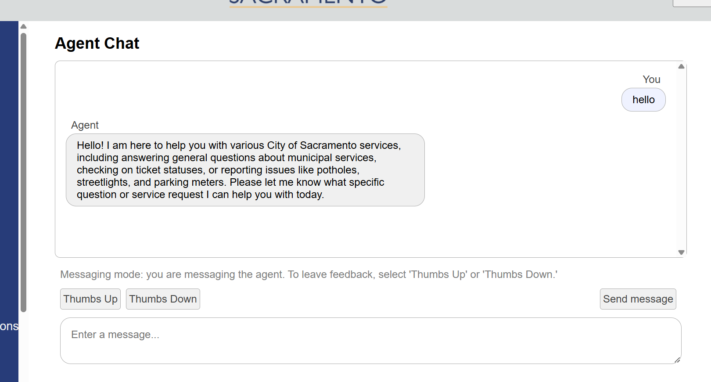

# Frontend
Frontend for a tool to go hand-in-hand with the 311 AI agent to help admins view or improve the functionality of the agent.


## Purpose
This dashboard is meant to show any useful data/analytics for admins of City of Sacramento to see what civilians are requesting help for and how the AI agents are able to respond to them. It also displays information on whether issues were resolved by maintanence/construction crews and allows admins to update information on tickets if it was not beforehand. The dashboard serves as the bridge between the AI agents and crew at City of Sacramento to resolve issues the people within the city may be facing.

## Development server

To start a local development server, in one terminal run:

```bash
cd frontend/
ng serve
```

---

In another terminal, run:

```bash
cd frontend/
npx json-server db_final.json
```

Once the server is running, open your browser and navigate to `http://localhost:4200/`. The application will automatically reload whenever you modify any of the source files.

## Login Screen

When first loading the application, the website prompts for a username and password using firebase authentication in order to access the admin dashboard.

## Layout / Navigation Guide

Within the dashboard, there are three main components. On the top, we have the header which has small navigation and task bar for logging out, viewing the profile. The left holds a collapsable navigation bar that holds every page. The body emcompasses the rest of the dashbaord that changes when a new page is selected. The header and sidebar never change no matter what page is selected.

## Overview
The overview is the default page after logging in that show general information about user and session logs with charts for depicting ticket progress and recent session creations.

The Ticket Progress depicts the count of tickets that are either in progress, closed, open, or new. 

The Latest Session depicts the the sessions within the current day, the past week, months, or years with the option to choose what to display.

## Contacts / Sessions / Service Requests / Flagged Conversations
The contact page lists every number that has used the 311 text line in which the user can go into further details by choosing a contact and seeing a list of all sessions that person has had. Choosing a session leads the user to session details which the sessions tab also does.

Choosing a session allows the admin to view both the messages the agent and user sent. It also shows the service request which depicts information like status, coordinates, and what kind of service is needed.

The flagged conversation tab leads back to the session detail page strictly for sessions that were deemed malicious.

## Requests

The request log allows for exporting any and all requests that have been made. To make it easier to find the requests an admin wants, there are multiple sorting and filtering features such as using a search bar, sorting by date, filtering by date, and filtering by topics.

## Agent Chat

The agent chat function allows for testing of the 311 agent.
-needs more information from me / need to learn more first

Try testing the agent to see if it is working properly.

Type:
```bash
Hello
```

and a response should be similar or identical to the image above should be provided.